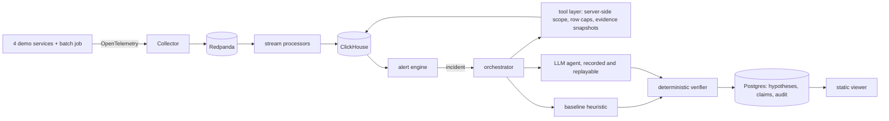

# Sentry-RCA

Sentry-RCA investigates production incidents. When an alert fires, it looks for the service and the kind of failure that caused it. It can use a deterministic heuristic, an LLM agent, or both. Either way, every cause it proposes is a set of typed claims that cite exact telemetry rows. A deterministic verifier recomputes each claim from those rows before anyone sees it, so an unsupported claim never reaches a person, whatever a model was persuaded to say.

**Live viewer:** <https://sohans1092004.github.io/sentry-rca/>. These are recorded investigations: the timeline, both rankers' hypotheses side by side, every claim with its verifier result, and the cited evidence. It is a static site, with no live endpoint.

## The result

**The deterministic baseline beat the LLM agent on held-out incidents.**

| 16 held-out test incidents, one run each | LLM agent (gemini-3.5-flash-lite, free tier) | Baseline (no model) |
|---|---|---|
| top-1 accuracy | 0.250 | **0.438** |
| top-3 accuracy | 0.250 | **0.500** |
| outcome correct | 5 / 16 | **8 / 16** |
| paired by incident | 1 win, 4 losses, 11 ties | |

**Why the agent lost.** It rarely managed to prove anything:
- it answered "insufficient evidence" on 8 of the 11 incidents that had a real cause;
- it used its whole 20-call budget in 11 of 16 runs;
- it never reported two competing causes.

**What held.** The verifier rejected none of the 41 true reference claims, and let no evidence from outside an investigation's scope through.

**How sure.** The comparison was pre-registered: the model and prompt were chosen on separate dev data, then frozen, then run on test once. It is one run per incident, because the free tier allows 500 requests a day. Identical runs on dev changed their top answer in 4 of 6 pairs, so the size of the loss is not established. The direction is the same on dev, on test and at every iteration.

The baseline's numbers are honest because the test data is. The first evaluation scored a perfect 1.00, because the fault injector's own log lines named the fault. The data was rebuilt and a leak test added before anything above was measured ([postmortem 001](docs/postmortems/001-fixture-answer-key-leak.md)).

## How it works



1. **Telemetry and alerting.** Metrics, logs and traces reach ClickHouse at-least-once, with stable row IDs. One edge SLO rule opens an incident.
2. **The baseline runs first.** It ranks causes from anomaly onsets, trace structure and deploy timing, and produces a verified answer before any model is called.
3. **The agent investigates** with read-only tools inside a scope the server decides. Tool results reach it as data inside random per-call boundaries. Its output must be strict JSON, and its budget is hard. If it fails, the investigation shows the baseline's answer.
4. **The verifier checks every claim** from the cited rows: a metric rose, a log pattern at least doubled, a span dominated the slow traces, a deploy preceded the onset. Outcomes are decided by rule from verified hypotheses only.

## Docs

- **[How Sentry-RCA was built](docs/how-sentry-rca-was-built.md):** the whole system and its result, with every claim sourced and every code reference checked by script.
- **[Interview guide](docs/interview-guide.md):** pitches, a question bank, stories, numbers and weak spots.
- **[Postmortems](docs/postmortems/):**
  - the fixture answer-key leak;
  - alert baseline contamination;
  - the replay-key contradiction;
  - the agent citing the baseline's calls.
- **[Phase 3 report](docs/report-phase3.md)** and its **[pre-registered analysis plan](docs/analysis-plan-phase3.md).**
- **[Specification](docs/SPEC.md),** with 44 dated amendments, and the **[ADRs](docs/adr/).**
- **Walkthroughs:** [Phase 1](docs/walkthrough-phase1.md), [Phase 2](docs/walkthrough-phase2.md), [Phase 3](docs/walkthrough-phase3.md). Each follows one span, or one investigation, through the code.
- **Measurements, with their commands:** [Phase 1](docs/measurements/phase1.md), [Phase 2](docs/measurements/phase2.md), [Phase 2.5](docs/measurements/phase2_5.md), [Phase 3](docs/measurements/phase3/).

## Run it

Everything runs locally and costs nothing. You need Docker and [uv](https://docs.astral.sh/uv/).

```sh
docker compose -f deploy/compose.yaml up -d --build      # the demo system and the stores
uv sync
uv run python -m common.migrate
uv run rca fixtures fetch                                # the 35 recorded fixtures (GitHub Release, sha256-checked)
uv run rca runbooks load                                 # the runbook corpus, from the recorded embeddings
uv run rca eval --n 5                                    # the baseline on dev and test
uv run rca eval --ranker agent --model gemini-3.5-flash-lite --llm replay --tag frozen --n 1 \
  --wall-s 600 --max-tokens 150000 --out agent-eval.json # the frozen agent, replayed: no key, no model
uv run python tools/export_viewer.py agent-eval.json _site   # the viewer, as published
```

Tests and checks:

```sh
uv run pytest tests/unit tests/integration          # integration tests use Testcontainers
uv run playwright install chromium && uv run pytest tests/viewer   # the viewer's XSS test
uv run python tools/guard_checks.py                 # remove each safety guard, watch its test fail, restore it
uv run python docs/tools/refs.py check              # every file:line reference in the docs
```

## Status

Feature-frozen after Phase 4 (SPEC amendment A44).

**Deferred, not built:**
- the interactive UI: verdicts, follow-ups, re-investigation;
- observability dashboards;
- further chaos runs;
- resumable investigations;
- live end-to-end runs;
- the concurrent-investigations measurement.

The fixture set has 3 injection fixtures, short of the 5 the spec asks for.
