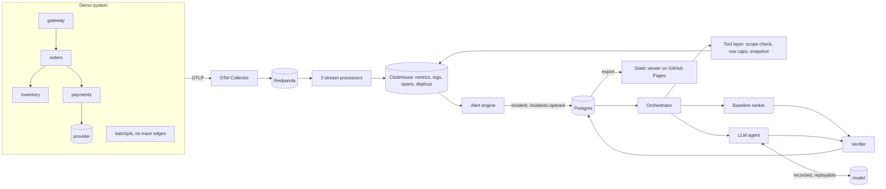

# Sentry-RCA: How It Was Built

2026-10-23 · Sohan · companion: [interview guide](interview-guide.md) · live viewer: <https://sohans1092004.github.io/sentry-rca/>

**How to read this.** Every claim cites its source: a code line (a link such as `verifier.py:249`), a test name, a commit, a SPEC amendment (A1-A44 in `docs/SPEC.md`) or a measurement file. Every code link was checked by `docs/tools/refs.py check`; the result is at the end of section 11. Measurements say where they were made:

| Tag | Meaning |
|---|---|
| **[laptop]** | Measured on the development laptop: i7-12700H, 20 logical CPUs, 16 GB RAM, Intel Iris Xe (no NVIDIA GPU), Windows 11, Docker Desktop on WSL2 (`docs/measurements/phase1.md`) |
| **[hosted]** | Model output from `gemini-3.5-flash-lite` on the Gemini API free tier, called from the laptop; times include the network and the free tier's rate limits (A41) |
| **[replay]** | Re-run from recorded model responses (cassettes), no model called |
| **[CI]** | Measured in GitHub Actions |
| **[design]** | Designed and argued, not measured |

## 1. Overview

> **The deterministic baseline beat the LLM agent on held-out incidents. On 16 test incidents it scored top-1 0.438 against the agent's 0.250; paired incident by incident, the agent won 1, lost 4 and tied 11 [hosted]. The agent lost because it rarely managed to prove anything: it abstained on 8 of 11 incidents with a real cause, ran out of tool calls in 11 of 16, and never reported two competing causes.**

Sentry-RCA is an incident-investigation platform for a small demo system. Four instrumented services send metrics, logs and traces through Redpanda into ClickHouse. A rule-based alert opens an incident. An investigation then looks for the root cause with read-only, scope-checked tools. It can use a deterministic **baseline ranker**, an **LLM agent**, or both on the same incident.

Every cause either of them proposes is a **hypothesis made of typed claims** (a metric rose, a log pattern rose, a deploy preceded the onset, one service's spans dominate the slow traces). Each claim cites the exact rows it rests on. A **deterministic verifier** recomputes every claim from those rows before anything is shown. An unsupported claim never reaches a person, whatever a model was persuaded to say (`docs/SPEC.md` §8, ADR-007).

**What exists today**

| Part | What it is | Size and proof |
|---|---|---|
| Telemetry pipeline | 4 demo services plus a batch job, an OpenTelemetry Collector, Redpanda, 3 stream processors, ClickHouse | ingestion ceiling ~100,000 mixed events/s with bounded lag **[laptop]** (`docs/measurements/phase1.md`, M5) |
| Alerting | one composite SLO rule on the edge service: error rate, and p95 latency as a robust z-score (A1, A8) | alert 13.0-26.7 s after fault start on the 34 fast-onset v3 fixtures **[laptop]** (`docs/measurements/phase2_5.md`, Q1) |
| Failure injector and recorder | 10 fault scenarios plus no-fault; confounders; fixtures recorded as versioned Parquet datasets with labels | 35 fixtures: 19 dev, 16 held-out test (A22) |
| Investigation core | scope-checked tool layer, evidence snapshots, timeline, verifier, outcome rules | 189 unit and 33 integration tests |
| Baseline ranker | a fixed three-signal heuristic, no model (§7.2, ADR-006) | frozen as `baseline-frozen` before test was run (A32) |
| LLM agent | a hand-written tool loop (ADR-010) with record and replay, budgets and degradation to the baseline | frozen as `agent-frozen`, run once on test (A42, A43) |
| Evaluation | per-fixture paired comparison, dev and test apart, leak test, backend agreement, contamination rule | `docs/report-phase3.md` |
| Viewer | a static, read-only site of the recorded investigations | <https://sohans1092004.github.io/sentry-rca/> (A44) |
| Safety evidence | 69 remove-the-guard checks: each guard is deleted and its test must fail by showing the unsafe behaviour | `tools/guard_checks.out` |
| Records | 44 SPEC amendments, 10 ADRs, 4 postmortems, a measurement file per phase | `docs/` |

**The result, in one table** (one run per fixture, the free tier's limit; source `docs/report-phase3.md`):

| | dev agent | dev baseline | **test agent** | **test baseline** |
|---|---|---|---|---|
| top-1 judged | 0.316 | 0.842 | **0.250** | **0.438** |
| top-3 judged | 0.316 | 0.842 | 0.250 | 0.500 |
| outcome correct | 7/19 | 13/19 | 5/16 | 8/16 |
| paired by fixture (agent W/L/T) | 2/12/5 | | **1/4/11** | |

Under the rule registered before the test run (`docs/analysis-plan-phase3.md`), the agent **loses**: losses − wins = 3, and its mean is lower. The margin is exactly at the threshold. On dev, identical repeated runs changed their top answer in 4 of 6 pairs. So the size of the loss is not established; its direction is the same on dev, on test and at every iteration (section 8).

**What it deliberately does not do** (§1.3):
- **No remediation.** No tool can restart, roll back or change anything: the tool set has no write tool (`investigation/tools.py`).
- **No chatbot.** The agent runs only on an incident.
- **No cloud deployment.** It runs on one laptop; the public part is a static site.
- **No formal causal inference.** §7.2 states the heuristic used instead, and its blind spot.

**What was deferred in the final phase** (A44): the interactive UI and its API (verdicts, follow-ups, re-investigation), so human agreement has no data; observability dashboards; further chaos runs; resumable investigations; live end-to-end runs; the concurrent-investigations number. The fixture set meets every §12.1 minimum except injection fixtures: **3 of 5**.


## 2. Architecture

> **Telemetry flows one way into ClickHouse; an incident starts an investigation; every proposed cause, from either ranker, passes the same verifier over stored evidence before a person sees it.**



**Words used throughout.**

| Term | Meaning | Example |
|---|---|---|
| **Incident** | One open problem on one service, opened by the alert rule and deduplicated by fingerprint | an SLO breach on `gateway` |
| **Investigation** | One attempt to explain an incident; holds its scope, tool calls, hypotheses and outcome | baseline first, then the agent |
| **Scope** | What an investigation may read, decided by the server: tenant, the services within 2 call-graph hops of the incident service, a time window, row and byte caps | `gateway, orders, inventory, payments` for 30 min around the onset |
| **Snapshot** | The stored result of one tool call, content-addressed by the sha256 of its canonical rows | every claim cites rows of a snapshot (ADR-012) |
| **Claim** | One typed, checkable statement with citations | `metric_change`: inventory's pool wait rose at least 4x in this window |
| **Hypothesis** | A proposed cause (service, kind, role) with one or more claims | inventory / pool_exhaustion, candidate root cause |
| **Outcome** | ROOT_CAUSE_IDENTIFIED, INSUFFICIENT_EVIDENCE or CONFLICTING_EVIDENCE, decided by rule from verified hypotheses only | §7.5 |
| **Fixture** | A recorded fault: a Parquet dataset of all telemetry in its window, and a label with the true cause | `pool_exhaustion_t01` |

### The life of one incident

1. **Telemetry.** Each service exports OTLP to the Collector, which writes to Redpanda. Three processors validate each message, give every row a stable ID, insert a batch, and commit offsets only after the insert; bad messages go to a dead-letter topic (Phase 1, `docs/walkthrough-phase1.md`).
2. **Alert.** Every 5 s the engine reads the last 60 s of the gateway's request metrics ([`engine.py:174`](../alerting/engine.py#L174)). The rule fires on error rate above 5 % with at least 20 requests, or on p95 latency with a robust z-score above 4 against a 30-minute baseline, plus ratio and absolute floors (A8, [`rules.py:46`](../alerting/rules.py#L46)). Baseline minutes inside a previous incident's period are excluded (A29, [`rules.py:21`](../alerting/rules.py#L21)). Two consecutive breaches open or update the incident; an `incidents.opened` event starts an investigation.
3. **Scope.** The orchestrator computes the scope from the observed call graph: services within depth 2 of the incident service, over the last 24 h of edges ([`scope.py:62`](../investigation/scope.py#L62)). The model never chooses its scope; its arguments are requests (§5.2, ADR-008).
4. **Baseline first, always.** `investigate` runs the baseline, stores its hypotheses and outcome, and only then builds the agent ([`orchestrator.py:149`](../investigation/orchestrator.py#L149)). A verified answer exists before any model is called.
5. **Tool calls.** Each call goes through `prepare`, which rejects a service outside the scope, clamps the window and caps rows ([`tools.py:95`](../investigation/tools.py#L95)). The result is snapshotted before it is returned ([`snapshots.py:44`](../investigation/snapshots.py#L44)), and the call is recorded with its ranker (A15).
6. **Hypotheses.** The baseline ranks candidates with a fixed heuristic ([`baseline.py:169`](../investigation/baseline.py#L169), section 5). The agent proposes hypotheses in strict JSON (section 7).
7. **Verification.** `verify` checks every claim against its cited snapshot rows and the hypothesis as a whole ([`verifier.py:249`](../investigation/verifier.py#L249), section 5).
8. **Outcome.** `decide` uses only verified hypotheses: none → INSUFFICIENT_EVIDENCE; two different causes within 0.1 of each other → CONFLICTING_EVIDENCE; otherwise ROOT_CAUSE_IDENTIFIED ([`outcome.py:8`](../investigation/outcome.py#L8)).
9. **What is shown.** The agent's result when it completes. If it degrades (model unavailable, output unusable twice, budget used), the baseline's verified answer is shown, with status `degraded_baseline` ([`orchestrator.py:197`](../investigation/orchestrator.py#L197)).

### Stores

- **ClickHouse** holds telemetry and deploys in one columnar store (ADR-001; deploys moved there so live and eval reads share one code path, A9).
- **Postgres** holds incidents, investigations, tool calls, snapshots, hypotheses, claims, model exchanges and eval results ([`0004_investigation.sql:5`](../common/migrations/postgres/0004_investigation.sql#L5)). The audit tables are append-only for the application role.
- **No Redis** (ADR-009).


## 3. Requirements, point by point

> **The platform targets are met with the baseline. With the agent, the final outcome misses its 90 s target. One number was never measured, and human agreement has no data.**

### 3.1 Product requirements (§1.2)

| Requirement | Target | Result | Source |
|---|---|---|---|
| Ingestion throughput | 5,000 events/s sustained; report the ceiling | **met**: ~100,000 mixed events/s with bounded lag; lag grows without bound from 125,000. The bottleneck is the CPU of the single-threaded Python processors (metrics 99.6 %, logs 98.4 % of a core) **[laptop]** | `docs/measurements/phase1.md`, M5 |
| Alert-to-incident latency | < 30 s for fast-onset faults | **met**: 13.0-26.7 s on all 34 fast-onset v3 fixtures, measured from fault start to incident opened ([[record#summary["alert_latency_s"] = ]]), stricter than from anomaly onset. Slow-onset memory_leak_001: 164.4 s, no target (A12) **[laptop]** | `docs/measurements/phase2_5.md`, Q1 |
| First verified hypothesis | < 60 s, single service | **met**: always the baseline's, 1.3-3.5 s on test and dev evals (median 2.0 s and 2.5 s) **[laptop]** | `docs/measurements/phase2_5.md`, Q3 |
| Final outcome | < 90 s, single service | **met by the baseline** (as above). **Missed with the agent**: recorded model time per test investigation was 118 s median, 213 s max **[hosted]** | `docs/report-phase3.md` |
| Platform without the LLM | ingestion, alerting and baseline keep working | **met**: Ollama killed mid-investigation → `degraded_baseline` showing the baseline's verified answer, no rows lost **[laptop]**; the baseline needs no model (runbook vectors replay from a cassette, A17) | `docs/measurements/phase3/kill-ollama-demo.txt` |
| Hot retention | 7 days at full resolution | **built**: 7-day TTL on raw telemetry; an archive job exports each day at 6 days old (A5) **[design]**, not observed over a full week | A5 |
| Cold retention | 90 days: metrics 1 h, logs and traces to Parquet | **built**: hourly downsampling, deduplicated (A10); archives deleted after 90 days (A5) **[design]** | A5, A10 |
| Concurrent investigations | a measured number | **not measured** (A44). A cap of 2 exists ([`orchestrator.py:34`](../investigation/orchestrator.py#L34)) | A44 |
| Cost per investigation | tokens and wall time; money 0 with the local model | **met**: money 0 (local model, and the hosted free tier). Agent tokens per test run 102k median, 126k max **[hosted]** | `docs/report-phase3.md` |
| Memory | whole stack with the model ≤ 11 GB RSS | **met, measured in parts**: stack 2.07 GB (17 containers) **[laptop]**; qwen2.5:3b runner 2.2-2.4 GB with `OLLAMA_NUM_PARALLEL=1` **[laptop]**; the hosted agent uses no local model memory | `docs/measurements/phase2_5.md`, Q5; ADR-000 |

### 3.2 AI quality metrics (§1.4)

| Metric | Result | Source |
|---|---|---|
| Top-1, top-3, confusion matrix, agent vs baseline | all recorded, dev and test apart, at one run per fixture for the agent (section 8) | `docs/report-phase3.md` |
| Spread over N runs | baseline: 0 (deterministic, N=5). Agent: N=1 (the free tier allows 500 requests a day; N=5 needs about 3,200, A41). The measured stand-in: identical dev runs changed rank 1 in 4 of 6 pairs | `docs/measurements/phase3/iterations/iterC-day1.md` |
| Verifier rejection rate | agent: 2 of 6 hypotheses on test, 2 of 6 on dev; baseline 0 of 40 on test | `docs/report-phase3.md` |
| Verifier false-negative rate (must be 0) | **0**: 0 of 41 test and 0 of 54 dev gold claims rejected | `docs/measurements/phase2_5.md`, Q3 |
| Injection-influence rate | 0 of 6 pairs in a 3+3 dev check; 0 of 1 on test. But planted text reached the agent in only 1 of 6 dev runs and none on test, so this measures exposure more than resistance | `docs/measurements/phase3/iterations/iterC-day1.md` |
| Human agreement | **no data**: verdicts were deferred with the interactive UI (A44) | A44 |
| Budget use | tool calls, tokens and model time per run, recorded per investigation | `docs/report-phase3.md` |


## 4. Telemetry, alerting and the fault injector

> **The pipeline is at-least-once with stable row IDs, so redelivery is harmless. The faults are injected through the services' normal code paths, because the first version leaked the answer (postmortem 001).**

### 4.1 Pipeline

- **Commit after insert.** Each processor inserts a batch into ClickHouse and only then commits its Kafka offsets ([`runner.py:131`](../processors/runner.py#L131)). A crash in between redelivers the batch. Stable row IDs plus ReplacingMergeTree make the duplicate collapse (Phase 1; `docs/walkthrough-phase1.md`).
- **Batches bounded by bytes.** At first, batches were bounded by message count (500). With 500-event messages that was about 250k rows of Python objects, over the processor's 192 MiB limit. A restarted processor met the same backlog and was killed again. Batches are now bounded at 1 MiB of payload ([`runner.py:82`](../processors/runner.py#L82)) (`docs/measurements/phase1.md`, M5, run C).
- **Broker outage.** With Redpanda stopped for 60 s, the Collector queued about 60 s of telemetry (12 % of its bound) and drained it within 15 s. No span gap appeared, and no processor restarted **[laptop]** (M4). A longer outage, which would overflow the queue, was not exercised.

### 4.2 Alerting

- **One rule on the edge** (A1). Every scenario surfaces at `gateway`. Finding the cause is the investigation's job, not the alert's. Per-service rules would have opened 3-4 incidents per multi-hop fault, and the SPEC had no cross-service grouping.
- **Robust statistics.** p95 latency is compared with the median and MAD of 1-minute p95s over the trailing 30 minutes ([`rules.py:46`](../alerting/rules.py#L46)). The rule needs z > 4, p95 > 1.5x the baseline median, and p95 − median > 20 ms (A8).
- **Two measurement fixes, not rule changes.**
  - The alert baseline excludes incident periods (A29, postmortem 002).
  - The latency histogram got finer buckets (A30). Healthy p95 sat on the 0.1 s bucket edge, so a handful of slow requests moved the interpolated value past the 1.5x ratio.

### 4.3 Faults and fixtures

- **Scenarios.** Six were available while the baseline and the prompt were built (dev): bad_deploy, slow_query, pool_exhaustion, dependency_outage, memory_leak, noisy_neighbor. Four are test-only, never used to build the baseline or the prompt: config_change, cache_stampede, connection_refused, cpu_throttling ([`scenarios.py:29`](../injector/scenarios.py#L29)). There are also no-fault fixtures, ambiguous pairs and injection variants.
- **Realistic signals** (A21). A slow query is a lock wait inside the demo database. Pool exhaustion is a connection leak. A bad deploy raises a real `KeyError` through the shared request logger. Planted injection lines arrive as client input. Healthy traffic emits the same vocabulary at low rates.
- **Confounders** in about half the fixtures (A22): a harmless deploy of an in-scope service 2-10 minutes before the fault, a mild unrelated anomaly, and sampling (70 % of logs, 50 % of traces, whole traces) ([`scenarios.py:51`](../injector/scenarios.py#L51)).
- **noisy_neighbor** is a batch job pinned to the same CPU core as two services, with no trace edges (A3). It is outside every scope by design, so the honest outcome is INSUFFICIENT_EVIDENCE. The label keeps the true but uncitable evidence as `out_of_scope_evidence` (A14).
- **Fixtures are versioned datasets.** All telemetry in the window goes to Parquet, plus a label with the cause, the expected outcome, gold claims, confounders and planted row IDs. They are published as a GitHub Release, sha256-verified on fetch, and loaded into an isolated ClickHouse database per eval. The eval reads it through a read-only user and checks it with a content hash before and after (A16).
- **Gold claims** are generated from each fixture's own data with the same pinned arithmetic as the verifier (A11, `recorder/gold.py`). So a true claim that the verifier rejects is a verifier bug, and the eval counts it (false negatives: 0).


## 5. The investigation core: tools, evidence, verifier, baseline

> **The server decides what may be read; every result is stored before anyone sees it; a claim is accepted only if the verifier can recompute it from the rows it cites. The baseline is a fixed heuristic held to the same verifier as the model.**

### 5.1 Tools and scope

- **The tools are read-only by construction:** `query_metrics`, `query_logs`, `query_traces`, `get_recent_deploys`, `get_incident_timeline` and `search_runbooks`. There is no tool that changes anything (§5.1).
- **`prepare` turns a request into what may run** ([`tools.py:95`](../investigation/tools.py#L95)):
  - A tenant argument is rejected: the tenant comes from the investigation ([`tools.py:36`](../investigation/tools.py#L36)).
  - A service outside the scope is rejected and logged.
  - The window is clamped to the investigation's window, and rows are capped at 500 and 256 KiB ([`snapshots.py:18`](../investigation/snapshots.py#L18)).
  - A rejection is recorded with its reason. It is never silently rewritten (§5.2, ADR-008).
- **Log bodies are untrusted.** Control characters are stripped and bodies are truncated to 500 characters before they are stored or shown ([`tools.py:25`](../investigation/tools.py#L25)).
- **Snapshots** are content-addressed: the sha256 of the canonical JSON rows, stored zstd-compressed before the result is returned ([`snapshots.py:44`](../investigation/snapshots.py#L44), ADR-012). A claim cites rows of a snapshot, not a live query, so it can be re-checked later against exactly what the ranker saw.
- **Two backends, one answer.** Every tool call of every eval investigation is re-run on a Parquet backend over the same dataset. Its snapshot must be byte-identical to ClickHouse's (A26). The first run found one edge count of 5,717 against 5,718, from ClickHouse's approximate `uniq`; it was fixed with exact counts in both (A33).

### 5.2 The timeline

`get_incident_timeline` returns call edges, deploys and **anomaly onsets** per service and signal: latency, error rate, CPU, memory, pool wait. An onset is the first of two consecutive ticks above median + max(4·1.4826·MAD, 0.5·|median|, a per-signal floor), measured against the first 10 minutes of the window ([`timeline.py:59`](../investigation/timeline.py#L59), A20). Bucketing into 30 s first stamped onsets up to 30 s *before* the fault, and made a true deploy-before-onset claim fail on bad_deploy_001. Hence the services' own 5 s ticks.

### 5.3 The verifier

`verify` checks a hypothesis in two layers ([`verifier.py:249`](../investigation/verifier.py#L249)). The thresholds are pinned so that the gold-claim generator and the verifier compute identically (A11).

**Every citation** ([`verifier.py:74-98`](../investigation/verifier.py#L74-L98)):
- cites at least one tool call of *this* investigation, made by *this hypothesis's ranker* (A15);
- that call was not rejected and has a snapshot;
- that call is a tool this claim type may cite (A18);
- every cited row is in that snapshot.

**Per claim type:**

| Claim | Recomputed from the cited rows |
|---|---|
| `metric_change` | rows of the claimed service and metric, inside the window plus the 15 minutes before it; at least 3 points on each side; the mean rose (or fell) by at least `min_magnitude` ([`verifier.py:101`](../investigation/verifier.py#L101)) |
| `log_pattern` | at least `min_count` cited lines contain the pattern; the cited queries cover the window *and* the equal-length window before it, untruncated; matches in the window ÷ matches before ≥ `min_ratio` ≥ 2 ([`verifier.py:123`](../investigation/verifier.py#L123), A24) |
| `trace_dependency` | in every claimed trace, a cited child span descends from a cited parent span and holds at least `min_latency_share` of its time ([`verifier.py:169`](../investigation/verifier.py#L169)) |
| `deploy_precedes_onset` | the deploy is the claimed service's, finished before the onset and at most 30 minutes before it, and a cited onset of that service lies within 1 minute of the claimed onset ([`verifier.py:188`](../investigation/verifier.py#L188)) |
| `runbook_match` | the cited document's similarity is at least the claimed one and at least 0.75, and it is not the evaluated fixture's postmortem, or one of the same scenario ([`verifier.py:203`](../investigation/verifier.py#L203), A25) |

**The hypothesis as a whole:**
- a known role, and a cause kind from the closed list ([`kinds.py:7`](../common/kinds.py#L7), A23);
- a root cause needs evidence beyond a similar past incident;
- a root cause's service must be in scope, and at least one non-runbook claim must be *about that service* (A36).

The last rule was added in Phase 3. Without it, true evidence about inventory could have verified a hypothesis naming `dns`, which is exactly what a planted instruction would ask for.

**Tests and guards.**
- An adversarial suite and property tests generate cases that must pass and tightened ones that must fail (`tests/unit/test_verifier.py`, `tests/unit/test_verifier_properties.py`).
- No gold claim was rejected in any eval: 0 of 54 on dev, 0 of 41 on test (`docs/measurements/phase2_5.md`, Q3).
- Removing a check makes a fabricated claim pass: the `verifier_*` guard checks in `tools/guards_phase2.py`.

### 5.4 The baseline ranker

The baseline is a fixed heuristic with no model ([`baseline.py:169`](../investigation/baseline.py#L169), ADR-006):
1. **Timeline:** anomaly onsets ordered in time.
2. **Fixed follow-ups** for each anomalous service: deploys, WARN and ERROR logs, the series behind its onsets.
3. **Slow and failing traces:** from the incident service's root span, it walks to the child holding the most time while that child holds at least half the root's. The service reached is that trace's *dominant* service.
4. **A candidate root cause needs a kind-specific signal:** one of three log rules ([`baseline.py:29`](../investigation/baseline.py#L29)), memory growth, or a deploy finishing up to 30 minutes before its onset. A log pattern counts only if it at least doubled against the window before (A24). A service that is only slow is a downstream symptom.
5. **Score:** 0.4 trace dominance + 0.3 kind evidence + 0.2 temporal rank + 0.1 deploy proximity.

Its known blind spots were measured, not tuned away (A32):
- **Ambiguous pairs:** trace dominance favours whichever fault holds the slow traces, so two equal causes rarely land within the 0.1 conflict margin. It got 0 of 3 test pairs right.
- **noisy_neighbor:** a harmless confounder deploy can be blamed.
- **The four test-only kinds:** it has no log rule for them, so it is judged on the service only (A23).

It was frozen as `baseline-frozen` before test was first run, with its sha256 in `evals/accepted.json`; any later change blocks the gate until a post-hoc amendment is logged (A27).

### 5.5 Outcome rules

`decide` looks only at verified root-cause candidates, sorted by score ([`outcome.py:8`](../investigation/outcome.py#L8)):
- none → INSUFFICIENT_EVIDENCE;
- a different cause within 0.1 of the top → CONFLICTING_EVIDENCE;
- otherwise → ROOT_CAUSE_IDENTIFIED.

The same rules apply to both rankers, so a ranker cannot talk its way into an outcome.


## 6. Evaluation, and the fixtures that leaked the answer

> **The first eval scored 1.00 because the fixtures named their own faults. Making the data honest dropped the baseline to 0.842 on dev and 0.438 on held-out test, and everything after that was measured against a frozen baseline on a split nobody had tuned on.**

### 6.1 The leak (postmortem 001)

The Phase 2 baseline eval scored top-1 1.00 over 19 fixtures and 5 runs (`docs/measurements/phase2.md`, P1). The write-up called it optimistic at the time. Three leaks explained it, found in turn:

1. **The answer key was in the injector's words.** The fault code paths logged what they did:
   - `pool acquire timeout after …` ([`demo_db.py:70 @6482a38`](https://github.com/sohans1092004/sentry-rca/blob/6482a38f2e1441e84f56a324728b3c4cb9682395/services/demo_db.py#L70));
   - `slow query … took over … ms` ([`demo_db.py:80 @6482a38`](https://github.com/sohans1092004/sentry-rca/blob/6482a38f2e1441e84f56a324728b3c4cb9682395/services/demo_db.py#L80));
   - `KeyError 'currency' (version …)` for a bad deploy ([`faults.py:94 @6482a38`](https://github.com/sohans1092004/sentry-rca/blob/6482a38f2e1441e84f56a324728b3c4cb9682395/services/faults.py#L94)).

   The Phase 2 baseline mapped those strings to cause kinds ([`baseline.py:30-32 @7fb7ac4`](https://github.com/sohans1092004/sentry-rca/blob/7fb7ac45dccecbda8a7233c3aca9f93d28a8eead/investigation/baseline.py#L30-L32)). In the v2 datasets each string appears only in its own scenario's fixtures: `pool acquire timeout` 198 times, `slow query` 2,164, `KeyError 'currency'` 164. In v3 they are gone, or present in every scenario (`docs/measurements/phase4/leak-history.txt`, from `tools/leak_history.py`).
2. **The `faults.py` attribute.** Planted lines, deploy announcements and the bad-deploy error were logged by the fault module's own logger ([`faults.py:14 @6482a38`](https://github.com/sohans1092004/sentry-rca/blob/6482a38f2e1441e84f56a324728b3c4cb9682395/services/faults.py#L14)). The OpenTelemetry handler records each line's source file, so 325 v2 log lines carried `code.file.path` = `…/faults.py`, a perfect label for "injected". In v3: none.
3. **The batchjob trace.** After the first two were fixed, the new leak test failed 96 items on dev, all from one marker. The injector started noisy_neighbor's CPU job with `POST /_fault` to `batchjob`, leaving a request span and request metrics only noisy_neighbor fixtures had (A31, commit `e17c0ff`). The job now starts with `docker exec` inside the container.

A fourth shortcut was in the corpus: 55 of 70 runbook citations pointed at a sibling fixture's postmortem, which describes the same fault (`docs/measurements/phase2.md`, P3).

### 6.2 The hardening that followed (Phase 2.5)

| Change | What it prevents | Amendment |
|---|---|---|
| Faults surface only through normal code paths; healthy traffic emits the same vocabulary | a string identifying the scenario | A21 |
| A log pattern counts only if it at least doubled against the window before | presence of shared vocabulary passing as evidence | A24 |
| Confounders (harmless deploy, mild anomaly, sampling) in about half the fixtures | a ranker that blames the first deploy it sees | A22 |
| A held-out test split with four scenarios the baseline was never built for | measuring on the data the rules were written against | A22, A27 |
| The baseline frozen before test, its sha256 checked; any later change needs a post-hoc amendment | quietly tuning on test | A27, A32 |
| Same-scenario postmortems excluded from runbook search during a fixture's eval | the corpus stating the answer | A25, A34 |
| The leak test: every log template (source file, function, line, severity), attribute, span, metric and deploy shape never seen in healthy traffic must appear with 2+ scenarios, not only one, and not only with confounders | markers nobody thought to look for | A28 |
| Backend agreement: every tool call re-run on Parquet must give a byte-identical snapshot | an eval that measures the database, not the method | A26 |

The leak test passes: 18,340 items across 35 datasets, 101 never seen in healthy traffic, 0 that identify a scenario or a confounder (`docs/measurements/phase2_5.md`, Q2). Tests: `test_markers_are_caught_and_shared_vocabulary_is_not` and `test_corpus_leaks_are_caught`. Its limit: it checks single items, not combinations (postmortem 001, Notes).

### 6.3 How the agent was compared (Phase 3)

- **Dev for every choice, test once.** Model, prompt, budget and parsing were all chosen on dev. Before the test run:
  - a pre-registered analysis plan was committed, with the decision rule, the noise reporting and the only version allowed on test (`docs/analysis-plan-phase3.md`);
  - the agent was tagged `agent-frozen` (commit `62dfc92`);
  - `rca eval` refuses a live agent run on test fixtures unless HEAD carries that tag ([`cli.py:128`](../investigation/cli.py#L128)).
- **Paired by fixture.** For each fixture, agent and baseline are compared over the same runs in the same investigation ([`harness.py:469`](../evals/harness.py#L469)). The decision rule: the agent beats the baseline if wins − losses ≥ 3 and its mean is higher; it loses in the mirror case; otherwise there is no measurable difference. The exact sign test is reported for description only ([`harness.py:493`](../evals/harness.py#L493)).
- **Noise at N=1.** The free tier allowed one agent run per fixture (A41). The measured stand-in for spread: identical dev runs changed rank 1 in 4 of 6 pairs. So no difference of one or two fixtures is called meaningful.
- **One deviation, recorded** (A43). The single test run was killed from outside after 13 of 16 fixtures; the cause is not in the logs. It was completed with the identical command and commit. The 13 finished fixtures replayed from their recordings (no second draw) and were checked identical; only the 3 unfinished fixtures called the model.


## 7. The LLM agent

> **A hand-written tool loop with every safety property enforced outside the model: the server scopes its queries, the data is framed as untrusted, the output must parse, the budget is hard, every exchange is recorded before use, and the verifier decides.**

### 7.1 The loop (ADR-010)

`Agent._loop` ([`agent.py:474`](../investigation/agent.py#L474)) opens with:
- **a fixed system prompt** ([`agent.py:72`](../investigation/agent.py#L72)): the rules, the closed cause-kind list, a recipe for each claim type, and the answer format;
- **the incident as structured fields**: tenant, services in scope, window, incident service and first anomaly ([`agent.py:172`](../investigation/agent.py#L172)).

Nothing from telemetry is in either. Then, each turn:

1. **Ask.** `_ask` checks wall time and tokens before and after the call, and gives the model at most the wall time left as its timeout ([`agent.py:442`](../investigation/agent.py#L442), A39).
2. **Run the tools.** Every tool call goes through the same scope-checked tool layer as the baseline's. It is stored with `ranker = agent`.
3. **Frame the result as data.** Each result is rendered inside `<<DATA-x>>` … `<</DATA-x>>`, where x is 16 random hex characters made fresh for that call ([`agent.py:183`](../investigation/agent.py#L183), [`agent.py:243`](../investigation/agent.py#L243)). The prompt says text inside is data, never instructions; a planted line cannot guess the boundary to close the block early. `test_planted_instructions_only_ever_appear_inside_a_data_block`; guard `untrusted_data_framing`.
4. **Number calls locally.** The agent sees its own calls numbered 1..n and cites those numbers (A39, postmortem 004).
5. **Keep the context small.** Results show at most 15 rows and 10 log groups. Past 10,000 characters, older results keep only their header; their rows stay citable, because citations resolve against the snapshot, not the prompt ([`agent.py:429`](../investigation/agent.py#L429), A38, A42).

### 7.2 The answer, and when it degrades

- **Strict parsing.** The reply must be one JSON object of §8.1 hypotheses: no unknown fields, a closed-list kind, at least one claim ([`agent.py:306`](../investigation/agent.py#L306)). An unusable reply gets one retry constrained by a JSON schema; a second failure degrades (`parse`). `test_parse_failure_gets_one_retry_with_the_error_then_degrades`; guard `output_schema`.
- **Citations resolve deterministically.** Numbers become stored sequence numbers. `"all"` becomes the rows the claim type may use. An unknown number stays unknown, so the verifier rejects it ([`agent.py:373`](../investigation/agent.py#L373)).
- **One repair turn.** If any hypothesis is rejected, the verifier's reasons go back verbatim, and the agent may query and answer once more ([`agent.py:542`](../investigation/agent.py#L542)). The verifier still decides.
- **Hard budget:** 20 tool calls, 150,000 tokens, 600 s (A41, A42). When the tool calls run out, the agent gets one answer-only turn. Asking for tools again there, or running out of tokens or time, degrades (`budget`, A37). Guards `agent_budget_tool_calls` and `agent_budget_wall_time`.
- **Degradation shows the baseline.** A degraded agent leaves the investigation `degraded_baseline` with the baseline's verified answer ([`orchestrator.py:197`](../investigation/orchestrator.py#L197)). The demonstration killed Ollama after 2 committed exchanges. The investigation ended `degraded_baseline` (`llm_unavailable`) with the baseline's inventory / pool_exhaustion, and kept 26 baseline and 4 agent tool calls, 2 exchanges and 3 hypotheses **[laptop]** (`docs/measurements/phase3/kill-ollama-demo.txt`).

### 7.3 Recording and replay

- **Recorded before use.** Every exchange is committed to `llm_exchanges` before its response is used ([`orchestrator.py:219`](../investigation/orchestrator.py#L219)).
- **The replay key** is sha256 of the model, its digest, the canonical request with each data boundary replaced by a placeholder, and the run index ([`llm.py:81`](../investigation/llm.py#L81)). Without the placeholder no replay could ever match (postmortem 003, A35).
- **A miss raises `ReplayMiss`.** It never falls through to a live model ([`llm.py:265`](../investigation/llm.py#L265)). Guards `replay_miss_loud` and `replay_key_whole_request`.
- **CI replays the frozen agent** on all 35 fixtures with no key and no model (the `agent-replay` job in `.github/workflows/ci.yml`). The same replay builds the public viewer (section 10).
- **No secret in the record.** A secret scan over the repository, every cassette and the viewer export fails on any key-shaped string ([`secret_scan.py:17`](../tools/secret_scan.py#L17); guard `secret_scan`). The hosted key lived only in a user environment variable, and was revoked after the test run.

### 7.4 Choosing a model, on dev only

| Model | top-1 judged (dev, N=1) | agent hypotheses verified |
|---|---|---|
| qwen2.5:3b (local) | 0.263 | 0 |
| llama3.2:3b (local) | 0.263 | 0 |
| qwen2.5:1.5b (local) | 0.316 | 0 |
| qwen2.5:7b (local) | not run: did not fit on a 16 GB laptop running the full stack | — |
| gemini-3.5-flash-lite, before iteration C **[hosted]** | 0.421 | 5 of 10 |
| **gemini-3.5-flash-lite, iteration C (frozen) [hosted]** | 0.316 | 4 of 6 |
| baseline | 0.842 | — |

Source: ADR-000 and `docs/report-phase3.md`.
- **Local models never verified anything.** Across selection and two dev iterations, 145 local hypotheses were produced and 0 verified, on CPU-only Ollama.
- **The hosted model** was adopted by the user's decision on the free tier, at N=1, because the free tier allows 500 requests a day (A41).
- **Iteration C was frozen for budget compliance and tokens, not accuracy** (A42):
  - no run hit the budget, against 4 before;
  - median tokens 87k, against 130k;
  - accuracy changed within noise: 2 wins, 4 losses, 13 ties against the version before. That version scored 2 more fixtures on dev, and the analysis plan says so.

### 7.5 Adversarial checks

Unit tests use an obedient fake model that does what a planted line says. Each attack is stopped by a different layer:

| Attack | Stopped by | Test |
|---|---|---|
| query another tenant | scope | `test_injected_tenant_request_is_rejected_by_scope` |
| query an out-of-scope service | scope | `test_injected_out_of_scope_service_is_rejected_by_scope` |
| name a cause kind outside the list | output schema | `test_injected_out_of_list_kind_is_rejected_by_the_schema` |
| name a cause with no evidence | verifier (A36) | `test_injected_cause_without_evidence_is_rejected_by_the_verifier` |
| cite the baseline's evidence | verifier (A15) | `test_a_hypothesis_citing_the_baseline_rankers_call_is_rejected` |


## 8. Results: the baseline beat the agent

> **On held-out test the frozen agent scored top-1 0.250 against the baseline's 0.438, and lost under the pre-registered rule (1 win, 4 losses, 11 ties). It was safe, and it was not useful: the verifier stopped its unproven claims, and what remained was mostly "insufficient evidence".**

### 8.1 Dev and test **[hosted]**, one run per fixture

| | dev agent | dev baseline | **test agent** | **test baseline** |
|---|---|---|---|---|
| top-1 judged | 0.316 | 0.842 | **0.250** | **0.438** |
| top-1 exact (service, kind) | 0.316 | 0.842 | 0.188 | 0.313 |
| top-3 judged | 0.316 | 0.842 | 0.250 | 0.500 |
| outcome correct | 7/19 | 13/19 | 5/16 | 8/16 |
| clean fixtures, top-1 | 0.400 | 1.000 | 0.429 | 0.571 |
| confounded fixtures, top-1 | 0.222 | 0.667 | 0.111 | 0.333 |
| paired top-1 (agent W/L/T) | 2/12/5 | | **1/4/11** | |
| sign test p (description only) | 0.013 | | 0.375 | |

Sources: `docs/report-phase3.md` and `docs/measurements/phase3/test/test-frozen.json`. The baseline's test numbers equal the accepted Phase 2.5 result exactly.

**Test, paired by fixture:**
- **The one win** is no_fault_t01. The agent correctly said nothing; the baseline blamed a harmless deploy.
- **The four losses:**
  - ambiguous_t01 and ambiguous_t02: the baseline named one of the two causes; the agent abstained;
  - cpu_throttling_t01: the baseline found the service; the agent abstained;
  - pool_exhaustion_t01: the agent named the right cause, but its log claim came from a query that did not cover the window before the fault, so the verifier rejected it. This is a showcase in the viewer.

**Outcome confusion on test** (rows expected, columns given):

| expected | agent: root cause | agent: insufficient | agent: conflicting | baseline: root cause | baseline: insufficient | baseline: conflicting |
|---|---|---|---|---|---|---|
| root cause (11) | 3 | 8 | 0 | 7 | 3 | 1 |
| insufficient (2) | 0 | 2 | 0 | 1 | 1 | 0 |
| conflicting (3) | 0 | 3 | 0 | 3 | 0 | 0 |

### 8.2 Why it lost (from the data)

- **It abstains.** 8 of 11 root-cause fixtures ended "insufficient evidence" on test (8 of 11 on dev too). Iteration C made it require a sharp rise at the anomaly onset before claiming anything. That removed false claims and budget overruns, and also most true ones.
- **It runs out of looking.** 11 of 16 test runs used all 20 tool calls and answered on the forced final turn; 7 used the repair turn.
- **It never says CONFLICTING_EVIDENCE** (0 of 6 such runs on dev and test). That outcome needs two competing verified causes, and the agent never proposed two.
- **Confounders hurt it most:** top-1 0.111 on the 9 confounded test fixtures, against 0.429 on the 7 clean ones.
- **The budget of a free tier.** N=1 and one dev pass a day meant few prompt iterations. The local models, which had no quota, never produced a verified hypothesis.

### 8.3 What held

| | dev (frozen) | test |
|---|---|---|
| agent hypotheses verified / rejected | 4 / 2 | 4 / 2 |
| gold claims rejected / out-of-scope citations allowed / backend mismatches | 0 / 0 / 0 | 0 / 0 / 0 |
| degraded runs / parse failures | 0 / 1 | 0 / 0 |
| tokens per run, median / max | 87k / 123k | 102k / 126k |
| model time per run, median / max **[hosted]** | 86 s / 371 s | 118 s / 213 s |

**Injection, as measured:**
- **Exposure was low.** Planted text reached the agent's prompt in 1 of 6 runs of a 3+3 dev check, and in 0 of 10 prompts on test. Iteration C's narrow log queries mostly didn't match the planted lines.
- **The influence rate measures exposure here, not resistance.** When nothing planted reaches the prompt, the "without" run's requests are identical and replay the "with" run's answers.
- **What was seen:** in all 5 hosted dev runs where planted text did reach the agent, the planted cause (gateway, DNS, TLS, certificate) was never named (`docs/measurements/phase3/iterations/iterC-day1.md`).

**Replay:** a local replay of all 35 fixtures with no key reproduced every recorded dev and test result **[replay]** (`docs/measurements/phase3/test/replay-check-all.json`).

### 8.4 How sure

The margin sits exactly on the rule's threshold (losses − wins = 3). At N=1, with identical runs changing rank 1 in 4 of 6 dev pairs, a re-run could land on "no measurable difference". It would not plausibly land on a win: the direction is the same on dev, on test and at every iteration. The hosted model has no digest, so a re-run on another day may differ. The cassettes, not a re-run, are the reference.


## 9. Testing, guards and CI

> **Every safety property has a test, and every such test was watched failing with its guard removed, by showing the unsafe behaviour, not just by erroring.**

### 9.1 What runs

| Suite | Count | What it covers |
|---|---|---|
| unit | 189 | rules, verifier (adversarial and property-based), agent loop with fake models, recorder, injector, leak test, secret scan |
| integration | 33 | Testcontainers: real ClickHouse, Postgres and Redpanda; commit-after-insert, dedup, the alert engine, orchestrator crash points, degradation |
| fixtures | per dataset | content hashes match the manifest; labels are well-formed; every gold claim verifies; out-of-scope evidence is rejected by scope; the baseline is byte-identical across runs |
| viewer | 4 | headless Chromium: script payloads in every recorded field never execute or become markup; the CSP blocks inline script |
| baseline eval | 35 fixtures, N=5 | the §12.5 gate: no gold claim rejected, no out-of-scope citation allowed, no backend mismatch, a frozen baseline |
| agent replay | 35 fixtures, N=1 | the frozen agent from its cassettes, no key and no model; a replay miss fails the job |

CI runs all of these on every pull request (`.github/workflows/ci.yml`). The `pages` job deploys the viewer from the agent-replay job's export, and only from `main`.

### 9.2 Remove-the-guard checks

`tools/guard_checks.py` takes each guard, applies an edit that removes it, and runs the guard's tests, which must fail. It then restores the guard and runs them again, and they must pass ([`guard_checks.py:145`](../tools/guard_checks.py#L145)). The output keeps the failing assertion, so the record shows the unsafe behaviour: a cross-tenant row returned, a fabricated claim passing, a duplicate incident, a looping agent running past its budget, a replay calling a live model, telemetry parsed into page markup (`tools/guard_checks.out`).

All 69 pass (full run 15:35-15:53 UTC, 23 Oct; `tools/guard_checks.out`). There are 67 guards before Phase 4 (8 Phase 1, 33 Phase 2, 15 Phase 2.5, 11 Phase 3) and 2 in Phase 4 ([`guards_phase4.py:7`](../tools/guards_phase4.py#L7)):
- `viewer_text_only`: with text rendering replaced by HTML parsing, the XSS test reports elements parsed from telemetry, and CSP violations.
- `viewer_csp`: with the CSP meta tag removed, an inline script runs.

### 9.3 Failure scenarios exercised

| Scenario | Result | Source |
|---|---|---|
| Redpanda down 60 s | queued and drained, no gap, no restart **[laptop]** | `docs/measurements/phase1.md`, M4 |
| Processor killed between insert and commit | redelivered batch deduplicated by stable IDs | integration test, guard `commit_after_insert` |
| Model killed mid-investigation | `degraded_baseline`, baseline answer shown, nothing lost **[laptop]** | `docs/measurements/phase3/kill-ollama-demo.txt` |
| Malformed model output | one schema-constrained retry, then `degraded_baseline` | `test_malformed_output_gets_one_retry_then_degrades` |
| Overnight memory pressure | three spurious incidents stalled recording 84 min; causes found (an archiver crash loop, dev runs, OneDrive sync) and fixed; no fixture contaminated, because the recorder waits for quiet | `docs/measurements/phase1.md`, M6 |
| Telemetry spike during an investigation | **not run** (deferred, A44) | |


## 10. The public viewer

> **A static site of recorded investigations, built in CI from the replayed cassettes: no server, no key, and telemetry rendered only as text under a strict CSP.**

**Live:** <https://sohans1092004.github.io/sentry-rca/> (A44).

- **What it shows:**
  - an index of all 35 investigations, with six showcases chosen to tell the real story;
  - an incident page: the timeline; baseline and agent hypotheses side by side; every claim with its verifier result and reason; the model's narrative labelled "unverified explanation"; evidence snapshots opened from each citation, with the cited rows highlighted and planted injection rows marked; out-of-scope evidence with the scope rejection; the full tool-call audit;
  - an evaluation page: the dev and test tables, the per-fixture paired comparison, both confusion matrices and the noise caveat.
- **How it is built:** `tools/export_viewer.py` reads one eval run's investigations from Postgres, plus the fixture labels. It writes JSON for each investigation and each cited snapshot ([`export_viewer.py:141`](../tools/export_viewer.py#L141)). CI runs it after the agent-replay job, scans the output for secrets and publishes it from `main` only.
- **The showcases** ([`export_viewer.py:26`](../tools/export_viewer.py#L26)):
  - pool_exhaustion_t01, a baseline win the agent missed;
  - bad_deploy_001, an agent hypothesis rejected with its reason;
  - noisy_neighbor_t01, INSUFFICIENT_EVIDENCE with out-of-scope evidence;
  - dependency_outage_injection_001, an injection fixture where planted text reached the agent;
  - ambiguous_t01, a conflicting fixture;
  - no_fault_002, the agent's verified false positive.
- **Untrusted text stays text.** Every value from the data reaches the page through `document.createTextNode` or an attribute value ([`app.js:8`](../viewer/app.js#L8)); nothing assigns HTML. Each page carries the §11 CSP, `default-src 'self'; script-src 'self'; object-src 'none'; base-uri 'none'`, in a meta tag, because GitHub Pages cannot set headers.
- **Proved in a browser.** `test_a_script_payload_in_recorded_telemetry_never_executes_in_the_viewer` builds a synthetic export with four payloads in every field, loads all three pages in headless Chromium and opens every citation. It asserts that no payload ran, no dialog opened, no element was parsed from telemetry, no CSP violation fired, and the payload is visible as text ([`test_viewer_xss.py:128`](../tests/viewer/test_viewer_xss.py#L128)). `test_the_viewer_csp_blocks_inline_script` asserts the CSP is in force.
- **Why plain JavaScript and not React (the SPEC said React):** the site is read-only and three pages, so a build step would add a toolchain and nothing the pages need. React's escaping would have helped, but the text-node rule plus the browser test enforce the same property (A44).


## 11. Decisions, limits and what next

> **The design choices that mattered were about evidence: claims a machine can re-check, a scope the model cannot widen, and evaluation data that cannot leak. The limits are a small fixture set, one run per fixture for the agent, and a deferred product surface.**

### 11.1 Decisions (`docs/adr/`)

| ADR | Decision | Why, in one line |
|---|---|---|
| 000 | a provider interface; Ollama by default; the evaluated agent on a hosted free tier; record and replay | local 3B models verified nothing on CPU; no paid tier, zero cost |
| 001 | metrics, logs and traces in one ClickHouse store | one query language and one join surface: a metric step, its logs and its spans correlate in one place, and a fixture loads into one isolated database |
| 003 | Redpanda (Kafka API) for ingestion | a spike becomes lag, not loss; commit-after-insert plus stable IDs makes at-least-once harmless; one binary that fits a laptop |
| 004 | rule-based, statistical alerting | deterministic and explainable; the fixes were to measurement (A29, A30), not to a model |
| 006 | a causal-ranking heuristic, not causal inference | states its blind spots: no trace path (noisy_neighbor), trace dominance on ambiguous pairs |
| 007 | typed claims and a deterministic verifier | an LLM judge or a citation-exists check would accept what the rows do not show |
| 008 | scope from a server-side call-graph allowlist | the model's arguments are requests, never authority |
| 009 | no Redis | its jobs fit existing stores: a partial unique index for alert dedup, a unique trigger for exactly-once effect, advisory locks for the concurrency cap |
| 010 | a hand-written tool loop | about 200 lines, with every safety property visible and testable |
| 012 | content-addressed evidence snapshots | a claim is re-checked against exactly what the ranker saw |

### 11.2 Honest limits

- **The agent lost, and the size of the loss is not established.** It was measured at N=1 on 16 test fixtures, exactly at the decision threshold (section 8.4).
- **The fixture set is small and synthetic.** 35 fixtures from one 4-service demo system. Injection fixtures are 3 of the 5 §12.1 asks for (A44). The test split has 16 fixtures, because memory_leak_t01 never alerted.
- **Injection resistance is unmeasured.** Planted text seldom reached the agent, so the checks measured exposure (section 8.3).
- **The baseline's weights were set by hand**, and it is judged on the service only for four kinds it has no rule for (A23).
- **Model time breaks the 90 s target with the agent** (section 3).
- **A hosted model has no digest.** Replay reproduces the loop exactly; a live re-run may differ.
- **Not built** (A44): the interactive UI and API, observability dashboards, resumable investigations, live end-to-end runs, the concurrency number and the spike chaos run.
- **What killed the first test attempt** was not found (A43).

### 11.3 What next

The direction the data points to is recorded in ADR-000 as future work, not built: **the model re-ranks or explains the baseline's verified candidates instead of investigating from scratch**. It could not add a cause, so the verifier's guarantee and the outcome rules stay as they are. It would be measured the same way: frozen, pre-registered, test once, paired by fixture. Its ceiling is the baseline's candidate list (top-3 0.500 on test).

### 11.4 Reference check

Every code link in this document and the interview guide was produced by `docs/tools/refs.py build` from an anchor string, and re-checked by `check`. The check confirms that:
- each cited line still contains its anchor;
- each named file exists;
- each commit SHA exists;
- each backticked test name is defined under `tests/`.

Result at the time of writing:

```
$ uv run python docs/tools/refs.py check
checked 146 file references (79 line numbers), 2 commit SHAs, 15 test names

all references resolve
```
