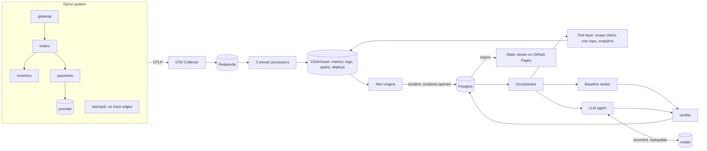

## 2. Architecture

> **Telemetry flows one way into ClickHouse; an incident starts an investigation; every proposed cause, from either ranker, passes the same verifier over stored evidence before a person sees it.**

**Words used throughout.**

| Term | Meaning | Example |
|---|---|---|
| **Incident** | One open problem on one service, opened by the alert rule and deduplicated by fingerprint | an SLO breach on `gateway` |
| **Investigation** | One attempt to explain an incident; holds its scope, tool calls, hypotheses and outcome | baseline first, then the agent |
| **Scope** | What an investigation may read, decided by the server: tenant, the services within 2 call-graph hops of the incident service, a time window, row and byte caps | `gateway, orders, inventory, payments` for 30 min around the onset |
| **Snapshot** | The stored result of one tool call, content-addressed by the sha256 of its canonical rows | every claim cites rows of a snapshot (ADR-012) |
| **Claim** | One typed, checkable statement with citations | `metric_change`: inventory's pool wait rose at least 4x in this window |
| **Hypothesis** | A proposed cause (service, kind, role) with one or more claims | inventory / pool_exhaustion, candidate root cause |
| **Outcome** | ROOT_CAUSE_IDENTIFIED, INSUFFICIENT_EVIDENCE or CONFLICTING_EVIDENCE, decided by rule from verified hypotheses only | §7.5 |
| **Fixture** | A recorded fault: a Parquet dataset of all telemetry in its window, and a label with the true cause | `pool_exhaustion_t01` |

### The life of one incident

1. **Telemetry.** Each service exports OTLP to the Collector, which writes to Redpanda. Three processors validate each message, give every row a stable ID, insert a batch, and commit offsets only after the insert; bad messages go to a dead-letter topic (Phase 1, `docs/walkthrough-phase1.md`).
2. **Alert.** Every 5 s the engine reads the last 60 s of the gateway's request metrics ([[engine#def tick(self, now: datetime)]]). The rule fires on error rate above 5 % with at least 20 requests, or on p95 latency with a robust z-score above 4 against a 30-minute baseline, plus ratio and absolute floors (A8, [[alerting/rules.py#def robust_z(]]). Baseline minutes inside a previous incident's period are excluded (A29, [[alerting/rules.py#def outside_incidents(]]). Two consecutive breaches open or update the incident; an `incidents.opened` event starts an investigation.
3. **Scope.** The orchestrator computes the scope from the observed call graph: services within depth 2 of the incident service, over the last 24 h of edges ([[scope#def allowed_services(]]). The model never chooses its scope; its arguments are requests (§5.2, ADR-008).
4. **Baseline first, always.** `investigate` runs the baseline, stores its hypotheses and outcome, and only then builds the agent ([[orch#def investigate(]]). A verified answer exists before any model is called.
5. **Tool calls.** Each call goes through `prepare`, which rejects a service outside the scope, clamps the window and caps rows ([[tools#def prepare(]]). The result is snapshotted before it is returned ([[snapshots#def build(]]), and the call is recorded with its ranker (A15).
6. **Hypotheses.** The baseline ranks candidates with a fixed heuristic ([[baseline#def rank(]], section 5). The agent proposes hypotheses in strict JSON (section 7).
7. **Verification.** `verify` checks every claim against its cited snapshot rows and the hypothesis as a whole ([[verifier#def verify(]], section 5).
8. **Outcome.** `decide` uses only verified hypotheses: none → INSUFFICIENT_EVIDENCE; two different causes within 0.1 of each other → CONFLICTING_EVIDENCE; otherwise ROOT_CAUSE_IDENTIFIED ([[outcome#def decide(]]).
9. **What is shown.** The agent's result when it completes. If it degrades (model unavailable, output unusable twice, budget used), the baseline's verified answer is shown, with status `degraded_baseline` ([[orch#except Degraded as e:]]).

### Stores

- **ClickHouse** holds telemetry and deploys in one columnar store (ADR-001; deploys moved there so live and eval reads share one code path, A9).
- **Postgres** holds incidents, investigations, tool calls, snapshots, hypotheses, claims, model exchanges and eval results ([[pg4#CREATE TABLE investigations (]]). The audit tables are append-only for the application role.
- **No Redis** (ADR-009).
